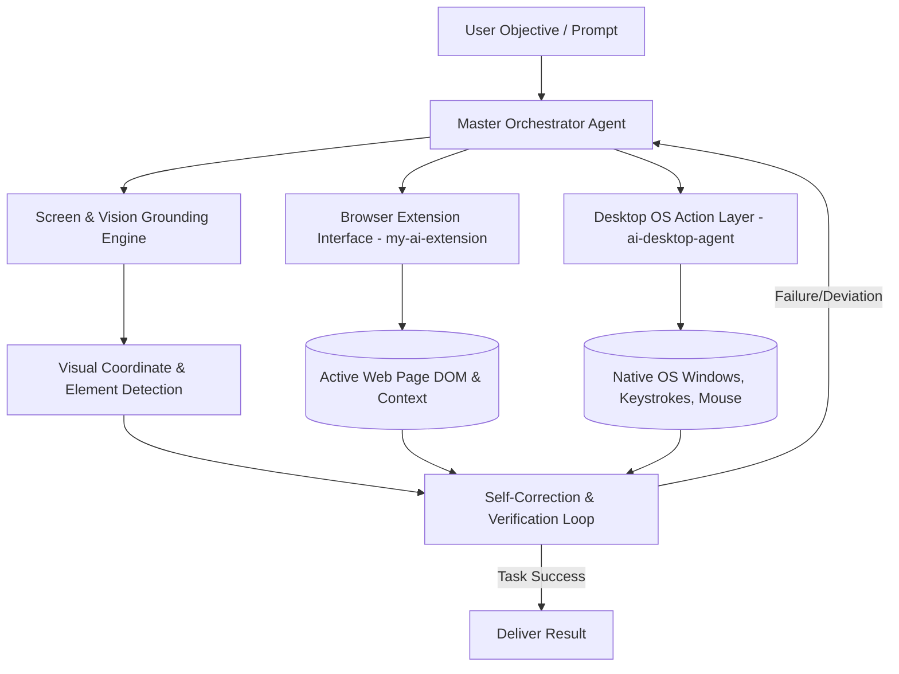

# 🤖 XARE-AGENT: Enterprise Autonomous Desktop & Extension AI Framework
> **Production-grade multi-agent autonomous system combining desktop automation, browser extension capabilities, and multimodal vision-guided agent execution.**

[](https://opensource.org/licenses/MIT)
[](https://www.typescriptlang.org/)
[]()
[]()

---

## 🏛️ System Architecture

XARE-AGENT orchestrates intelligent desktop control, browser interactions, and autonomous task synthesis across multiple specialized agents.



---

## 🚀 Key Modules & Sub-systems

| Sub-system | Path | Description |
|---|:---|:---|
| **AI Desktop Agent** | [`ai-desktop-agent/`](./ai-desktop-agent/) | Native OS automation engine handling window control, screen capture, OCR, and input simulation. |
| **Browser AI Extension** | [`my-ai-extension/`](./my-ai-extension/) | Manifest V3 Chrome extension providing in-page context injection, form filling, and DOM manipulation. |
| **Antigravity Engine** | [`antigravity/`](./antigravity/) | Autonomous multi-agent coordination core with self-healing feedback loops. |

---

## 📦 Quick Start

### Prerequisites
* Node.js >= 18.0.0 or Bun >= 1.0
* TypeScript 5.x

### Installation & Setup
```bash
# Clone the repository
git clone https://github.com/harinish45/XARE-AGENT.git
cd XARE-AGENT

# Install dependencies for Desktop Agent
cd ai-desktop-agent
npm install
npm run build

# Load Extension
# Open Chrome -> chrome://extensions -> Load Unpacked -> select 'my-ai-extension/'
```

---

## 🤖 Vibe Coding & Autonomous AI Tool Instructions
This repository is optimized for autonomous AI pair programmers (Cursor, Claude, Copilot, Antigravity):
* [`PRD.md`](./PRD.md) — Comprehensive functional specifications and system architecture.
* [`ROADMAP.md`](./ROADMAP.md) — Multi-sprint roadmap and deliverables.
* [`TODO.md`](./TODO.md) — Atomic implementation checklist with unit test acceptance criteria.
* [`AGENTS.md`](./AGENTS.md) — Coding standards and invariant rules for AI code generation.

---

## 📄 License
This project is licensed under the **MIT License** - see the [LICENSE](LICENSE) file for details.
