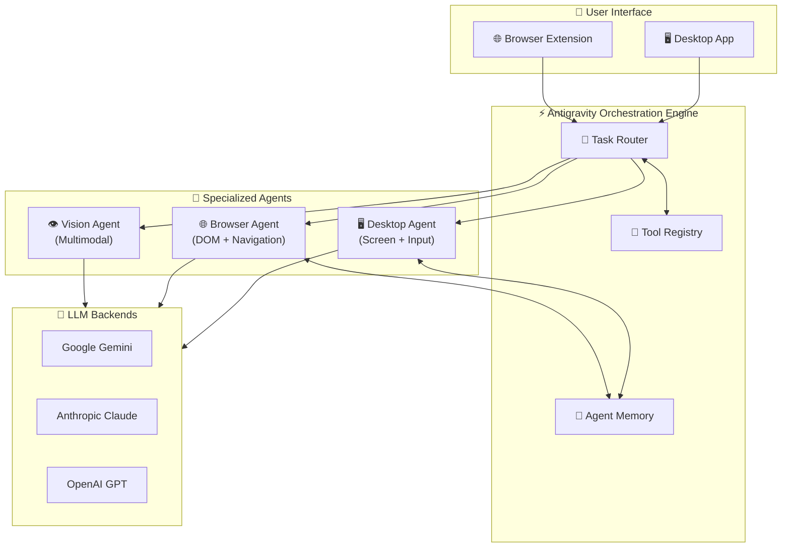
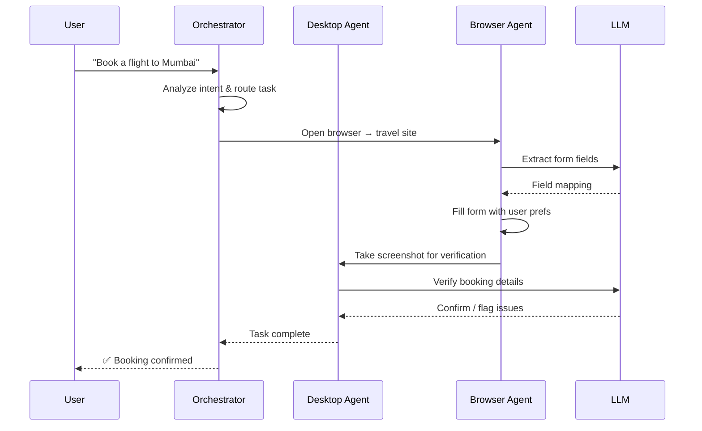

<div align="center">

# ⚡ XARE-AGENT

**Enterprise Autonomous AI Agent Framework**

[](https://github.com/harinish45/XARE-AGENT/actions/workflows/ci.yml)
[](LICENSE)
[](SUMMARY.md)
[](TODO.md)

> *Production-grade multi-agent orchestration for desktop automation, browser control, and multimodal AI execution*

[📋 Roadmap](TODO.md) · [📊 Sprint Summary](SUMMARY.md) · [📄 PRD](PRD.md)

</div>

---

## 🏗️ System Architecture



---

## 🤖 Multi-Agent Flow



---

## ✅ Sprint Progress

| Sprint | Theme | Status |
|--------|-------|--------|
| Sprint 1 | Core Orchestration Engine | ✅ Complete |
| Sprint 2 | Desktop + Browser Agents | ✅ Complete |
| Sprint 3 | Multi-Agent Coordination | ✅ Complete |
| Sprint 4 | Memory + Tool Registry | 🔧 In Progress |
| Sprint 5 | Evaluation + Optimization | 📋 Planned |

---

## 📁 Structure

```
XARE-AGENT/
├── ⚡ antigravity/          # Core orchestration engine
├── 🖥️  ai-desktop-agent/   # Desktop automation agent
├── 🌐  my-ai-extension/    # Browser extension agent
├── 📄  PRD.md              # Product requirements
├── 🗺️  ROADMAP.md          # High-level roadmap
├── 📊  SPRINT_*_SUMMARY.md # Sprint docs
└── 📋  TODO.md             # Detailed task list
```

---

## 🚀 Quick Start

```bash
git clone https://github.com/harinish45/XARE-AGENT.git
cd XARE-AGENT/antigravity
npm install
npm start
```

---

<div align="center">
<a href="LICENSE">MIT License</a> · Built with ❤️ by harinish45
</div>